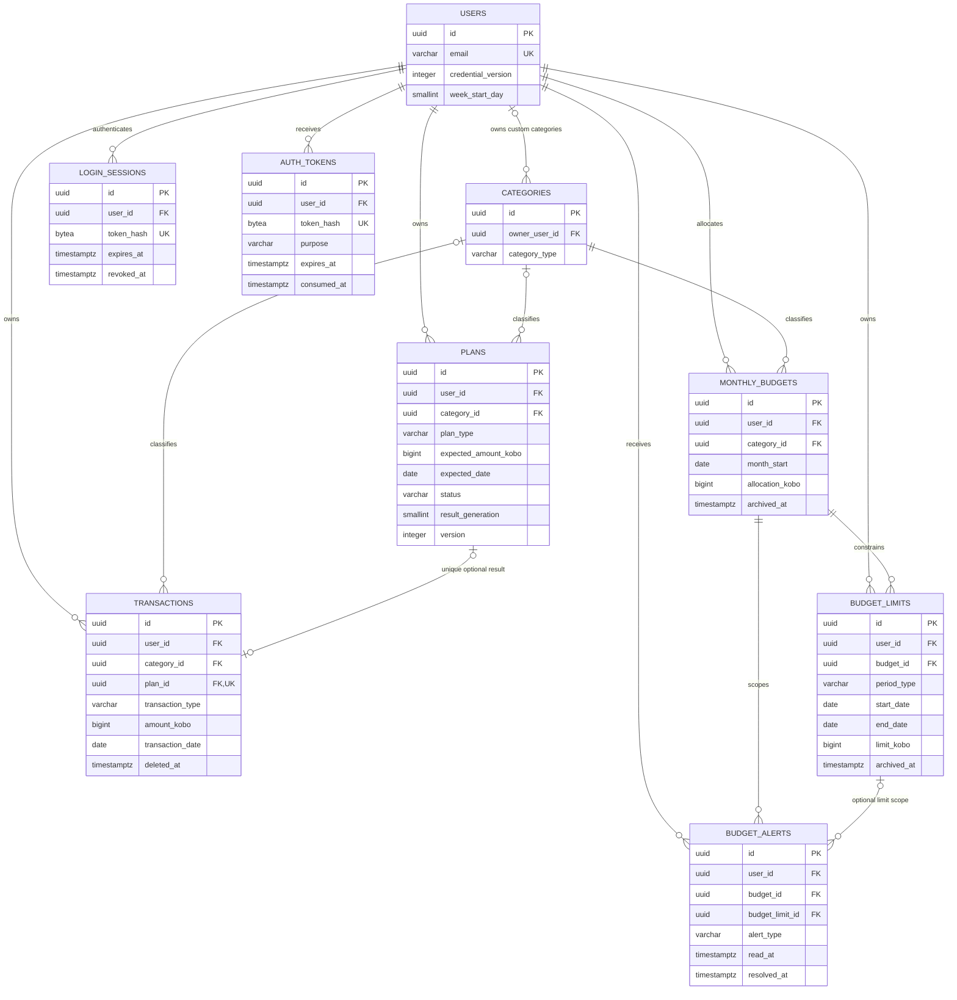

# FinSet Database Schema Design

**Status:** Phase 1.3.2 reviewed Phase 1 design. O1-O10 are resolved below. This is a documentation-only deliverable; it does not implement models, migrations, SQL, database changes, or application features. Phase 1.4 requires separate approval.

## 1. Scope and Existing Configuration

The official project is `C:\Users\USER\student-budget-prototype`. The proposed schema is for PostgreSQL, accessed through Flask-SQLAlchemy and managed by reviewed Flask-Migrate migrations.

The established configuration references from Phase 1.3.1 are:

- [`backend/app/config.py`](../backend/app/config.py): PostgreSQL/psycopg URLs, separate development/testing configuration, local database-name checks, and production environment handling.
- [`backend/app/__init__.py`](../backend/app/__init__.py): an application factory that binds extensions without creating a schema.
- [`backend/app/extensions.py`](../backend/app/extensions.py): shared SQLAlchemy and Migrate objects.
- [`backend/requirements.txt`](../backend/requirements.txt) and [`README.md`](../README.md): the established stack and environment setup.

The configured database names are `finset_dev` and `finset_test`. They must receive the same reviewed schema in a later phase, but never share data. This revision reads and changes only this Markdown document. Neither database was connected to, and no application imports or executable tests were run.

The original [project documentation](Student%20Budget%20and%20Expense%20Tracker%20Project%20Documentation.pdf) and [diagrams](Student_Budget_Tracker_Diagrams.pdf) remain unchanged. Current approved requirements take precedence over their earlier SQLite design and independent daily/weekly budget model.

### 1.1 Implementation scope

| Classification | Phase 1 treatment |
| --- | --- |
| Required application behavior | Accounts/profile/preferences, secure revocable sessions, actual income/expenses, explicit plan recording, recoverable transaction deletion, monthly allocations, optional daily/weekly limits, in-app warnings, financial reports, and user-initiated account deletion. |
| Required financial/security controls | Integer kobo, centrally configured limits, backend ownership checks, atomic financial updates, duplicate-plan prevention, current/past actual dates, and PostgreSQL-based integrity/concurrency tests. Frontend route guards are UX only. |
| Approved presentation/platform direction | Browser printing for initial reports; PWA installability if feasible. Neither requires another database table. |
| Approved Phase 1 privacy feature | User-initiated account deletion is approved and included in Phase 1. The authenticated user must deliberately initiate it, explicitly confirm it, and freshly re-authenticate with their password. Revoke their active sessions and remove their associated live data under the documented deletion rules. It remains an additional privacy feature beyond the original supplied documentation. |
| Ordinary recovery operations | Restricted PostgreSQL backups, documented backup frequency/retention, and an operator-run restore process with explicit recovery-point limitations. |
| Deferred production hardening | External deletion registers, automated erasure reconciliation/replay, coordinated restore fences, comprehensive change journals, and stronger recovery guarantees. None is a Phase 1 schema or acceptance prerequisite. |
| Excluded from Phase 1 | Automatic account deletion for inactivity and inactivity-warning emails; partial payments; recurring plans; savings goals/ledger; banking integrations, wallets or transfers; offline financial entry; dedicated CSV/PDF export. |

No balance, report, financial journal, deletion-register, or generic audit-history table is proposed.

### 1.2 Resolved decisions

"Resolved" means the design decision is settled, not that its implementation already exists.

| Decision | Final Phase 1 decision | Implementation status |
| --- | --- | --- |
| O1 | NGN only; DD/MM/YYYY default with the three approved formats; Monday default with Sunday available; System default with Light/Dark alternatives. | Resolved; reflected in user/limit constraints and acceptance criteria. |
| O2 | Explicit "Record money received" / "Record expense paid" actions use confirmed actual amounts. Undo precedes editing a recorded plan. Reuse the retained result and allow at most one replacement after purge. | Resolved; unique link, lifecycle versioning, and a bounded result-generation counter specified. |
| O3 | Actual dates must be today or earlier in Africa/Lagos; future expectations remain plans. | Resolved; mandatory service validation. |
| O4 | NGN 10,000,000 entry cap and NGN 1,000,000,000 cap for each of the five named scopes; preserve existing data after a cap reduction and reject increases to an already-over-cap value. | Resolved; one central policy and atomic before/after validation specified. |
| O5 | Current allocations editable; past-month budgets read-only; future allocations editable/removable through archival. Limits are independently editable, without changing actual transactions. | Resolved; archival fields and calendar-based edit rules specified. |
| O6 | Monthly allocations are primary; daily/weekly constraints are optional, independent tracking views. Monthly-only budgets are valid. | Resolved; no child-limit sum is added to an allocation and statuses remain scope-specific. |
| O7 | Custom names are case-insensitively unique per account, including across category types. Other accounts and system categories may use the same names; system/custom labels distinguish them. | Resolved; custom uniqueness changed and system categories protected. |
| O8 | User-initiated account deletion is approved and included in Phase 1 as an additional privacy feature beyond the original documentation. It requires deliberate authenticated initiation, explicit confirmation, fresh password re-authentication, active-session revocation, and associated live-data removal. No inactivity deletion, warning timer, or associated emails. | Resolved; user-initiated deletion is required in Phase 1 and automatic inactivity deletion remains excluded. |
| O9 | Ordinary restricted backups and a practical restore process; up to 30 days is a proposed retention policy, not an established guarantee. Older snapshots may reintroduce deleted live records. | Resolved for Phase 1; automated erasure replay and restore-cutover infrastructure deferred. |
| O10 | PostgreSQL backups provide Phase 1 recovery. Post-backup changes may be lost; no separate financial journal or automated replay system. | Resolved for Phase 1; stronger guarantees deferred. |

## 2. Entity Overview

The proposal contains **nine application tables**.

| Entity / table | Purpose and justification | Ownership |
| --- | --- | --- |
| User / `users` | Account identity, password hash, verification state, preferences, and credential invalidation. No automatic inactivity-deletion state. | The account holder; security fields are server-controlled. |
| Category / `categories` | Shared predefined classifications and private custom classifications in one table. | System when `owner_user_id` is NULL; otherwise exactly one user. |
| Transaction / `transactions` | The actual income/expense ledger, including recoverable deleted records and an optional plan link. | Exactly one user. |
| Plan / `plans` | Expected income/planned expenses and the lifetime allocation of their one retained actual result, including the one allowed replacement. | Exactly one user. |
| MonthlyBudget / `monthly_budgets` | One primary allocation for an expense category/calendar month, retained when archived. | Exactly one user. |
| BudgetLimit / `budget_limits` | Optional daily/weekly tracking windows with independent settings and archival. These are not additional allocations. | Exactly the same user as the parent monthly budget. |
| BudgetAlert / `budget_alerts` | Budget-warning events, their scope, and read/resolution state. Not a source of financial totals. | Exactly the same user as the referenced budget and any referenced limit. |
| LoginSession / `login_sessions` | Revocable server-side login state associated with an opaque cookie credential. | Exactly one user; managed by authentication services. |
| AuthToken / `auth_tokens` | Expiring, single-use verification, password-reset, and email-change credentials. | Exactly one user; managed by authentication services. |

### Why two proposed entities are combined or omitted

- **No `UserPreference` table initially.** Appearance, currency, date format, and week start are four small, mandatory one-to-one account settings with the same lifecycle as the user. Explicit columns on `users` are simpler than another table or an unvalidated JSON document. Separation can be reconsidered if preferences acquire a substantially different lifecycle.
- **Combine `EmailVerificationToken` and `PasswordResetToken` into `AuthToken`.** Both require the same ownership, hash, expiry, consumption, and revocation controls. A required purpose and purpose-specific constraints prevent cross-use. The already-approved email-change confirmation flow fits this model without a third token table.
- **No deletion-register or replay subsystem in Phase 1.** Ordinary backup limitations are documented in section 9 rather than addressed by an additional table or service.
- **No budget revision table.** Current/future settings can change; closed-month allocation/limit records are read-only. Archival preserves their rows. Reports use the current corrected transaction ledger, not an immutable history of every earlier edit.

## 3. Storage and Policy Conventions

### 3.1 Identifiers and relational keys

- Use PostgreSQL `uuid` primary keys, with the native `gen_random_uuid()` default, for all nine tables. UUIDs are serialized as strings to JavaScript clients.
- `users.id` is a stable ownership identity independent of a changeable email address. No external register is required to use UUIDs.
- UUIDs for the remaining entities give consistent API identifiers. They cost more index space than integer keys, which is an acceptable tradeoff for this project; they do not prevent data rollback during a backup restore.
- UUIDs are not authorization. Every private read and write still needs the authenticated user scope.
- Application creation never accepts client-selected primary keys. New accounts receive fresh UUIDs, including re-registration with a previously deleted email. A snapshot restore preserves the identifiers and relationships contained in that snapshot; it may restore previously deleted records.
- Identity/ownership immutability is enforced by the trigger rules in section 6. A primary key alone does not prevent changing an unreferenced identifier. UUIDs are not a deletion history or a recovery guarantee.
- Primary keys and candidate-key `UNIQUE` constraints are nondeferrable. A foreign key cannot target a partial or deferrable unique constraint.
- Some tables need an additional composite candidate key containing an already-unique UUID. That storage is justified by PostgreSQL's requirement for an exact referenced key for composite ownership foreign keys, not by a second uniqueness requirement in the product.

### 3.2 Money and configurable ceilings

All monetary columns use `bigint` and contain **integer kobo**, never decimal naira, `real`, `double precision`, or floating-point application values.

| Policy | Phase 1 value or status | Configuration responsibility |
| --- | --- | --- |
| Minimum positive entry | 1 kobo | `backend/app/config.py` |
| Maximum individual entry | NGN 10,000,000 = 1,000,000,000 kobo | `backend/app/config.py` |
| Maximum per named aggregate scope | NGN 1,000,000,000 = 100,000,000,000 kobo | `backend/app/config.py` |
| Warning threshold | 80 percent, fixed in Phase 1 | Approved invariant; no user-adjustable alternative |
| Transaction recovery | 30 days | Central lifecycle configuration |
| Session idle / absolute lifetime | 30 minutes / 8 hours | Central lifecycle configuration |
| Verification / reset / email-change token lifetime | 24 hours / 30 minutes / 1 hour | Central lifecycle configuration |
| Invalid credential cleanup | Within 24 hours of invalidation | Central lifecycle configuration |
| Backup retention | Proposed up to 30 days; the project must confirm and operate the actual policy | Restricted backup operations, not a promised database erasure guarantee |
| Reporting timezone | `Africa/Lagos` | Central configuration |

This document does not add settings to application code. The eventual implementation keeps all configurable monetary ceilings in `backend/app/config.py` and applies them through one shared validation policy; services and frontend components must not maintain competing constants. There is no account-inactivity deletion configuration.

The approved common entry ceiling also applies to plan amounts, individual monthly allocations, and individual tracking limits. The aggregate ceiling is not a limit on signed balance alone: large income and expense totals must not cancel each other to evade validation.

**Structural database constraints versus configurable limits:** monetary columns are required positive `bigint` values, with a database check such as `amount_kobo >= 1`. The PostgreSQL type also has its intrinsic storage range. Do not repeat the configurable NGN 10,000,000 ceiling as a separate hard-coded database `CHECK`, or introduce a policy table/function just to synchronize duplicate ceilings. Application services enforce the current entry ceiling and all five aggregate ceilings before committing. Controlled imports and maintenance writers must use the same validation; privileged direct SQL is not an application-policy enforcement path.

| Scope | Exact aggregation population |
| --- | --- |
| A1: active actual income | All `transactions` for one user with type `income` and `deleted_at IS NULL`, regardless of reporting range. |
| A2: active actual expenses | All `transactions` for one user with type `expense` and `deleted_at IS NULL`. |
| A3: pending expected income | All `plans` for one user with type `income` and status `pending`, including overdue plans. |
| A4: pending planned expenses | All `plans` for one user with type `expense` and status `pending`, including overdue plans. |
| A5: monthly allocations | `allocation_kobo` for one user and one `month_start`, excluding archived monthly budgets. |

Completed/cancelled plans are excluded from A3/A4, but their stored expected amounts remain subject to the individual-entry policy. Daily/weekly limits are individually bounded entries; they do not create a sixth allocation aggregate. Never net A1 against A2 or A3 against A4.

For every affected stored amount and aggregate, let `before` and `after` be its values and `cap` its current configured ceiling. If `before <= cap`, require `after <= cap`. If `before > cap` because the cap was lowered, allow only `after <= before`. Thus reductions and neutral metadata changes remain possible without deleting or clipping history; increases are rejected until the value is within the cap. Other restrictions still apply: this exception does not make a past-month budget editable.

A newly created record, including a replacement after purge, has no grandfathered amount (`before = 0`). An existing retained row is evaluated against its stored amount; restoration/reactivation must additionally pass the aggregate changes from becoming active. Evaluate the complete proposed state atomically, not each update in isolation. Reads still show truthful grandfathered totals above a lowered business cap.

`SUM(bigint)` can return PostgreSQL `numeric`. This is an exact intermediate aggregate, not floating-point storage. Validate its range and convert an integral result to a Python integer without passing through `float`.

Backend input validation must reject booleans, fractional kobo, non-finite values, and decimal-naira input with more than two decimal places, including a value such as `1.230`. An integer storage type cannot detect precision that a caller already rounded away; PostgreSQL casts are not a substitute for validating the original input. Frontend decimal input must be parsed exactly into kobo, not with `parseFloat(value) * 100`.

The initial configured scopes fit JavaScript safe integers; even `100000000000 * 100` is exact. Validate configuration changes against the chosen exact wire representation. Historical comparison totals outside the five capacity scopes are not given a new business cap: compute them exactly and verify any conversion to JavaScript `Number`, using an exact integer-string representation if necessary rather than rounding. Use integer cross-multiplication for warning decisions. Display formatting and chart geometry are not financial calculation sources.

### 3.3 Dates, timestamps, and defaults

- Use `date` for financial transaction dates, expected dates, calendar-month keys, and tracking-window boundaries.
- These dates are business dates in `Africa/Lagos`, not UTC dates obtained by truncating `created_at`.
- Actual transaction dates must be today or earlier on the Africa/Lagos calendar. Validate this on creation, date correction, recording, and restoration using fresh server time. A future date belongs to a plan; reaching that date never records money automatically. Do not rely on a time-dependent `current_date` row check.
- Use `timestamp with time zone` (`timestamptz`) for system events, security expiry, deletion, and audit timestamps. PostgreSQL stores instants; application connections and server-generated values use UTC, and timestamp API values use an explicit offset, normally `Z`.
- Every `date` and `timestamptz` value must be finite. Apply `CHECK (isfinite(column))` to non-null fields and its nullable equivalent to optional fields. PostgreSQL's infinity values must not create permanent tokens or unbounded periods.
- Financial/report windows are half-open: `[start_date, end_date)`. An interface can display an inclusive last day by showing `end_date - 1`.
- `CURRENT_TIMESTAMP` defaults apply only to insertion. They do not automatically update `updated_at`. Mutation services must set `updated_at` and advance any optimistic version explicitly, including in bulk updates.
- Creation timestamps are immutable after insertion. A business transaction date can be corrected without rewriting when FinSet originally recorded the row.
- Security and retention eligibility must use a fresh server UTC instant after obtaining the relevant locks, not a cached client time or an old eligibility calculation.
- In the specifications below, **None** means no database default; the service must supply a value. **NULL** denotes the nullable initial state.

### 3.4 Scope of defaults and choices

The tables below are the implementation design for the resolved Phase 1 requirements, not existing tables. User-initiated account deletion is approved and included in Phase 1, while remaining an additional privacy feature beyond the original project documentation. Defaults are NGN, DD/MM/YYYY, Monday, and System appearance. There is no currency conversion or automatic account-inactivity deletion.

### 3.5 SQLAlchemy compatibility

| PostgreSQL representation | SQLAlchemy representation |
| --- | --- |
| `uuid` | `Uuid(as_uuid=True)` with a PostgreSQL UUID server default |
| `bigint` monetary values | `BigInteger` |
| `integer` / `smallint` | `Integer` / `SmallInteger` |
| `varchar` / `text` | `String(length)` / `Text` |
| `char(3)` currency code | `CHAR(3)` |
| `date` | `Date` |
| `timestamptz` | `DateTime(timezone=True)` |
| `bytea` digests | `LargeBinary`, plus the explicit database byte-length check |

Use named `CheckConstraint`, `UniqueConstraint`, and multi-column `ForeignKeyConstraint` objects. Small categorical vocabularies use strings plus checks rather than native enum types, keeping later vocabulary migrations understandable. Partial indexes, NULLS NOT DISTINCT, and deferred constraint triggers remain explicit PostgreSQL-specific migration objects.

Restricted parent relationships must not let SQLAlchemy automatically null or delete financial children. Use appropriate passive-delete configuration, such as `passive_deletes="all"` for restrictive relationships, and do not add `delete`/`delete-orphan` cascades to categories, plans, or budgets. Otherwise deleting a category could first erase an optional income category reference and evade the intended database restriction.

Define composite relationship joins explicitly. Services assign authenticated ownership and scalar foreign keys deliberately; a relationship assignment must not silently overwrite the authenticated `user_id` with another object's owner. Read-only relationship navigation can avoid competing ORM writers for shared composite-FK columns. Resolve mapper overlap warnings deliberately rather than merely suppressing them.

## 4. Column Specifications

### 4.1 `users`

| Column | PostgreSQL type | Nullable | Default | Constraints | Explanation |
| --- | --- | --- | --- | --- | --- |
| `id` | `uuid` | No | `gen_random_uuid()` | Primary key; immutable | Stable account identity used by ownership foreign keys. |
| `full_name` | `varchar(120)` | No | None | Nonempty after trimming | Profile/display name, not a login identifier. |
| `email` | `varchar(254)` | No | None | Normalized, nonempty, unique | Store a consistently trimmed/lowercase login address; full email-format validation is a service responsibility. |
| `password_hash` | `text` | No | None | Nonempty; maximum 1,024 characters | Encoded secure password hash including algorithm parameters and salt; never plaintext. |
| `email_verified_at` | `timestamptz` | Yes | NULL | Finite; if set, not before `created_at` | Verification of the current address. |
| `credential_version` | `integer` | No | `1` | Positive; must not decrease | Invalidates credentials issued against an older security state. |
| `appearance` | `varchar(6)` | No | `'system'` | One of `light`, `dark`, `system` | Display preference only. |
| `currency` | `char(3)` | No | `'NGN'` | Must equal `NGN` in Phase 1 | Records the supported display currency without pretending to support conversion or multiple monetary units. |
| `date_format` | `varchar(10)` | No | `'DD/MM/YYYY'` | One of `DD/MM/YYYY`, `MM/DD/YYYY`, `YYYY-MM-DD` | Approved display formats; storage remains `date`. |
| `week_start_day` | `smallint` | No | `1` | One of 1 or 7 | Approved choices: Monday (default) and Sunday, using ISO numbering. |
| `last_successful_login_at` | `timestamptz` | Yes | NULL | Finite; server-controlled | Login/security information only; it does not schedule account deletion. |
| `created_at` | `timestamptz` | No | `CURRENT_TIMESTAMP` | Finite | Account creation timestamp. |
| `updated_at` | `timestamptz` | No | `CURRENT_TIMESTAMP` | Finite; not before `created_at` | Last service-maintained account mutation time. |

Additional constraints and rules:

- Store `email = lower(btrim(email))`; place a nondeferrable unique constraint on this normalized column. An email format is not validated with an improvised database regular expression.
- Persist appearance as `system`, `light`, or `dark` and present the labels System, Light, and Dark. There are no inactivity-warning, scheduled-account-deletion, or deletion-marker fields.
- `credential_version` changes on password replacement/reset and changes to verified identity. Initial verification, successful email change, and explicit account-wide credential invalidation use the same invalidation procedure. Ordinary preference/name changes do not invalidate sessions.
- Credential-version changes must revoke affected session/token rows as part of the same database transaction. The version comparison is additional protection, not an excuse to omit recorded revocation.
- Profile update payloads cannot set hashes, verification timestamps, credential versions, ownership, or lifecycle fields.
- Approved Phase 1 user-initiated account deletion must respect the financial foreign keys: the user row cannot be deleted until owned live data is removed. Credential cascades provide a final safety net; shared categories are never user children. There is no automatic inactivity-deletion path.

### 4.2 `categories`

| Column | PostgreSQL type | Nullable | Default | Constraints | Explanation |
| --- | --- | --- | --- | --- | --- |
| `id` | `uuid` | No | `gen_random_uuid()` | Primary key; immutable | Stable classification identifier. |
| `owner_user_id` | `uuid` | Yes | NULL | FK to `users.id`, delete/update RESTRICT; immutable including NULL transitions | NULL means system-owned; otherwise a private custom category. |
| `name` | `varchar(80)` | No | None | Nonempty after trimming; custom names unique case-insensitively per account | Visible category label; not the relationship key. |
| `category_type` | `varchar(7)` | No | None | `income` or `expense`; immutable | Prevents an expense category from becoming an income category underneath existing records. |
| `archived_at` | `timestamptz` | Yes | NULL | Finite | Hides a category from new selections without destroying historical references. |
| `created_at` | `timestamptz` | No | `CURRENT_TIMESTAMP` | Finite | Creation timestamp. |
| `updated_at` | `timestamptz` | No | `CURRENT_TIMESTAMP` | Finite; not before `created_at` | Rename/archive/update timestamp. |

Uniqueness is enforced with two partial unique indexes:

- System categories: `(lower(btrim(name)), category_type)` where `owner_user_id IS NULL`.
- Custom categories: `(owner_user_id, lower(btrim(name)))` where `owner_user_id IS NOT NULL`. Do not include `category_type` in this key: an account cannot create both an income and expense custom category with the same case-insensitive name.

Archived rows remain subject to those uniqueness rules. Reuse/unarchive or rename the existing custom category rather than create a duplicate. Different accounts may use the same custom name, and a custom name may match a system name. Category selectors and reports must distinguish System and Custom where labels collide. Relationships and grouping use category UUIDs, never names.

Only a restricted maintenance/seeding role may create or change system-owned rows. Application category operations create custom rows using the authenticated user ID and cannot promote a custom category to a global category.

Referenced categories use **ON DELETE RESTRICT**, including references from soft-deleted transactions. Do not use `ON DELETE SET NULL` for ownership: that would convert a private category into a global category. Do not cascade category deletion into financial records.

### 4.3 `transactions`

| Column | PostgreSQL type | Nullable | Default | Constraints | Explanation |
| --- | --- | --- | --- | --- | --- |
| `id` | `uuid` | No | `gen_random_uuid()` | Primary key; immutable | Identifier for one actual record. |
| `user_id` | `uuid` | No | None | FK to `users.id`, delete/update RESTRICT; immutable | Actual owner, supplied by the authenticated service. |
| `transaction_type` | `varchar(7)` | No | None | `income` or `expense`; must match a linked plan | Gives the amount its financial direction. Amounts themselves remain positive. |
| `amount_kobo` | `bigint` | No | None | Positive integer in PostgreSQL; central entry policy enforced on writes | The actual amount received or spent; initial application ceiling is 1,000,000,000 kobo. |
| `transaction_date` | `date` | No | None | Finite; service requires today or earlier in Africa/Lagos | Effective financial date, not an expected future date. |
| `category_id` | `uuid` | Yes, for income only | NULL | FK to `categories.id`, delete/update RESTRICT; category-access guard | Required for expense; optional for income. |
| `source` | `varchar(120)` | Yes, except for income | NULL | Income requires a nonempty trimmed value | Income source such as allowance or employment; normally NULL for an expense. |
| `description` | `varchar(1000)` | Yes | NULL | Length limited by type | User notes; never executable markup or SQL. |
| `plan_id` | `uuid` | Yes | NULL | Unfiltered UNIQUE; owned/type-matching composite FK; immutable after insertion | Optional originating plan. NULL is an ordinary manually recorded transaction. |
| `version` | `integer` | No | `1` | Positive | Optimistic concurrency counter advanced by mutation services. |
| `deleted_at` | `timestamptz` | Yes | NULL | Finite; paired with recovery deadline | Logical deletion; immediately removes the financial effect. |
| `recoverable_until` | `timestamptz` | Yes | NULL | Finite; strictly after `deleted_at` | Snapshot of the approved 30-day recovery deadline, not a second financial balance. |
| `created_at` | `timestamptz` | No | `CURRENT_TIMESTAMP` | Finite | When FinSet recorded the entry. |
| `updated_at` | `timestamptz` | No | `CURRENT_TIMESTAMP` | Finite; not before `created_at` | Last mutation time. |

Additional constraints:

- An expense requires `category_id IS NOT NULL`; an income requires a nonempty `source`.
- `deleted_at` and `recoverable_until` are both NULL for an active record, or both present for a deleted record. Deletion time cannot precede creation time.
- The composite plan FK is `(user_id, plan_id, transaction_type)` referencing `plans(user_id, id, plan_type)`, with `MATCH SIMPLE` and delete/update RESTRICT.
- All parts except optional `plan_id` are `NOT NULL`. Consequently, the composite FK is skipped only for an intentionally unlinked transaction, not for an omitted owner/type.
- `UNIQUE(plan_id)` is immediate and **includes soft-deleted rows**. Multiple NULL plan IDs are allowed. A partial unique index limited to undeleted rows would incorrectly allow a second retained transaction for the same plan.
- `plan_id` cannot be cleared, reassigned, or attached later through an ordinary edit to free or move a reserved plan slot. Phase 1 does not match an existing manual transaction to a plan after the fact.
- Inserting a linked result uses the plan's bounded result-generation allocator described below. Restoring/updating the same retained result is not an insertion and does not consume another generation.
- There is no expected amount, pending status, signed amount, running balance, or independent confirmation flag here. A valid inserted actual record is confirmed actual money; deletion controls whether it contributes to totals.

### 4.4 `plans`

| Column | PostgreSQL type | Nullable | Default | Constraints | Explanation |
| --- | --- | --- | --- | --- | --- |
| `id` | `uuid` | No | `gen_random_uuid()` | Primary key; immutable | Stable planning identity. |
| `user_id` | `uuid` | No | None | FK to `users.id`, delete/update RESTRICT; immutable | Owner. |
| `plan_type` | `varchar(7)` | No | None | `income` or `expense`; fixed economic identity | Expected income versus planned expense. A different direction requires a new plan, not reassignment of a retained result. |
| `expected_amount_kobo` | `bigint` | No | None | Positive integer; central entry policy applies in every plan state | Expected amount, never substituted for the explicit actual amount. |
| `expected_date` | `date` | No | None | Finite | Expected receipt/payment date; a past pending date is overdue, not completed. |
| `category_id` | `uuid` | Yes, for income only | NULL | FK to `categories.id`, delete/update RESTRICT; category-access guard | Expected classification. |
| `source` | `varchar(120)` | Yes, except for income | NULL | Income requires a nonempty trimmed value | Expected income source. |
| `description` | `varchar(1000)` | Yes | NULL | Length limited by type | Planning notes. |
| `status` | `varchar(9)` | No | `'pending'` | `pending`, `completed`, or `cancelled` | Lifecycle state, not a transaction status. |
| `completed_at` | `timestamptz` | Yes | NULL | Finite; present exactly when status is completed | Most recent explicit completion; cleared by undo. |
| `result_generation` | `smallint` | No | `0` | Between 0 and 2; nondecreasing; controlled by result allocation | 0 means no result allocated, 1 means the original was allocated, 2 means the single replacement was allocated. Preserved through undo and result purge. |
| `version` | `integer` | No | `1` | Positive | Rejects stale confirmation, undo, and editing requests. |
| `created_at` | `timestamptz` | No | `CURRENT_TIMESTAMP` | Finite | Creation timestamp. |
| `updated_at` | `timestamptz` | No | `CURRENT_TIMESTAMP` | Finite; not before `created_at` | Last mutation timestamp. |

Additional constraints:

- An expense plan requires a category; an income plan requires a source.
- A nondeferrable candidate key `UNIQUE(user_id, id, plan_type)` is the target of the transaction's composite FK.
- A row check requires `completed_at IS NOT NULL` exactly when `status = 'completed'`; a completion timestamp cannot precede creation.
- The cross-table final-state rule in section 6 requires exactly one active linked transaction for a completed plan, and no active linked transaction for a pending/cancelled plan.
- Do not add `plans.transaction_id` as a second independently writable link. The reverse relationship is obtained from the transaction's unique `plan_id`.
- Do not store an actual amount on the plan. Expected NGN 50,000.00 is `5000000` kobo here; an actual receipt of NGN 45,000.00 is `4500000` kobo on the linked transaction. Completing the plan must not overwrite the expectation to make them agree.
- Creating or editing an unrecorded plan never creates an actual transaction. Use the explicit action **Record money received** for income or **Record expense paid** for expense, with the actual amount, actual date, and user confirmation.
- A recorded/completed plan cannot be edited in place. Undo its recording first, then edit the pending plan and explicitly record again. Ordinary unlinked transaction editing remains available; the linked-result editor must not bypass this workflow.
- The generation counter is one small piece of Phase 1 lifecycle metadata required by O2, not a financial history table. It prevents repeated hard purges from resetting the one-replacement entitlement. Once generation 2 has itself been purged, this plan cannot allocate a third result; a new explicit plan or manual transaction is required.
- `overdue` is derived from a pending state and date; no clock-maintained overdue flag is needed.

### 4.5 `monthly_budgets`

| Column | PostgreSQL type | Nullable | Default | Constraints | Explanation |
| --- | --- | --- | --- | --- | --- |
| `id` | `uuid` | No | `gen_random_uuid()` | Primary key; immutable | Primary allocation identity. |
| `user_id` | `uuid` | No | None | FK to `users.id`, delete/update RESTRICT; immutable | Owner. |
| `category_id` | `uuid` | No | None | FK to `categories.id`, delete/update RESTRICT; expense category; immutable identity | Expense category receiving the allocation. |
| `month_start` | `date` | No | None | Finite; day of month equals 1; immutable identity | Calendar-month key; it cannot be moved to bypass the historical-edit rule. |
| `allocation_kobo` | `bigint` | No | None | Positive integer; central entry and A5 policies | Primary monthly allocation; no copies are added for child limits. |
| `warning_percent` | `smallint` | No | `80` | Must equal 80 in Phase 1 | Approved warning threshold; no user-adjustable alternative is required in Phase 1. |
| `archived_at` | `timestamptz` | Yes | NULL | Finite; ordinary archival/reactivation restricted to future months | Removes a future budget from active allocations while retaining its history and references. |
| `version` | `integer` | No | `1` | Positive | Guards stale budget edits. |
| `created_at` | `timestamptz` | No | `CURRENT_TIMESTAMP` | Finite | Creation time. |
| `updated_at` | `timestamptz` | No | `CURRENT_TIMESTAMP` | Finite; not before `created_at` | Last edit time. |

Additional constraints:

- `UNIQUE(user_id, month_start, category_id)` includes archived rows. Reusing an archived future allocation reactivates that row rather than creating a duplicate logical budget.
- `UNIQUE(user_id, id)` supports owned child references.
- The end of the month is derived as the first day of the next calendar month. No separately mutable month-end column is needed.
- This table contains no spent, remaining, balance, or sum-of-limits columns.
- The allocation's user/category/month identity stays fixed. Current-month amounts may be edited; past-month budgets are read-only; future amounts may be edited, archived, or explicitly reactivated. Date-sensitive permissions are checked by services against the Africa/Lagos month after locking, not by a volatile database `CHECK`.
- Ordinary removal archives the row, never erases its limits/alerts or actual transactions. Archive/reactivation changes A5; all archived allocations are excluded from the active monthly total but remain available as clearly labelled history.
- An archived parent disables its limits for active monitoring without overwriting each child's own archive state. Reactivation must validate capacity and dependent limits again. Historical transactions are not rewritten by any budget operation.

### 4.6 `budget_limits`

| Column | PostgreSQL type | Nullable | Default | Constraints | Explanation |
| --- | --- | --- | --- | --- | --- |
| `id` | `uuid` | No | `gen_random_uuid()` | Primary key; immutable | One explicit tracking window. |
| `user_id` | `uuid` | No | None | FK to `users.id`, delete/update RESTRICT; immutable | Owner, also checked against the parent budget. |
| `budget_id` | `uuid` | No | None | Composite owned-budget FK; immutable | Parent monthly allocation. |
| `period_type` | `varchar(6)` | No | None | `daily` or `weekly`; immutable limit kind | Tracking period, never another allocation type. |
| `start_date` | `date` | No | None | Finite; inclusive | First tracked business date. |
| `end_date` | `date` | No | None | Finite; exclusive; greater than start | First date not included in this window. |
| `week_start_day` | `smallint` | Yes, for daily only | None; service supplies snapshot | NULL for daily; 1 or 7 for weekly | Monday/Sunday convention used for the stored window. |
| `limit_kobo` | `bigint` | No | None | Positive integer; central entry policy | Explicit user-entered tracking limit; never automatically prorated or added to monthly allocation. |
| `archived_at` | `timestamptz` | Yes | NULL | Finite; follows the parent month's edit policy | Disables an optional limit without removing its historical alert relationships. |
| `version` | `integer` | No | `1` | Positive | Guards stale limit edits. |
| `created_at` | `timestamptz` | No | `CURRENT_TIMESTAMP` | Finite | Creation timestamp. |
| `updated_at` | `timestamptz` | No | `CURRENT_TIMESTAMP` | Finite; not before `created_at` | Last edit timestamp. |

Additional constraints:

- `(user_id, budget_id)` references `monthly_budgets(user_id, id)` with delete/update RESTRICT.
- `UNIQUE(user_id, budget_id, id)` is the candidate key for an alert's owned-limit reference.
- A partial unique index on `(budget_id, period_type, start_date)` where `archived_at IS NULL` rejects duplicate active starts. An archived predecessor can remain for history. The owned candidate key above is still nonpartial for FK use.
- Limits inherit the parent budget's `warning_percent`; no separate per-limit warning override is proposed.
- A daily window has `week_start_day IS NULL` and `end_date = start_date + 1`.
- A weekly window has `week_start_day IN (1, 7)` and a duration from one through seven days. A shorter window is only a month-boundary portion, not an arbitrary rolling week.
- Row checks require the start and `end_date - 1` to be in the same calendar month. For a weekly window, its start must be the snapshotted weekday or the first day of the month, and its exclusive end must be that weekday or the first day of the next month.
- The service additionally verifies that this month equals the parent budget's `month_start`, and that the window is the exact intersection of the intended week with that monthly period.
- The service rejects overlapping non-archived windows of the same type under the same budget while holding the user/budget locks. The exact-start unique index alone does **not** prevent all overlaps. Daily and weekly windows may overlap each other because they are distinct tracking views.
- A limit is effective only when it and its parent are not archived. Current/future-month limits may be edited independently of the allocation; past-month limits are read-only. Disabling an optional current/future limit archives it. Reactivation rechecks overlap and entry policy.
- A budget may have zero effective limits. No child limit is automatically created, copied, summed into, or required to equal the monthly allocation. There is no additional rule requiring a child cap to be below the monthly allocation; each scope reports its own utilization.
- PostgreSQL row checks/uniqueness plus the mandatory locked service checks are the Phase 1 design. Additional database-only overlap exclusion is not a Phase 1 extension or acceptance prerequisite.

Changing a user's weekday preference does not change existing rows. New windows snapshot the new preference; conflicting existing windows need an explicit edit, not automatic rebucketing.

### 4.7 `budget_alerts`

| Column | PostgreSQL type | Nullable | Default | Constraints | Explanation |
| --- | --- | --- | --- | --- | --- |
| `id` | `uuid` | No | `gen_random_uuid()` | Primary key; immutable | One warning event. |
| `user_id` | `uuid` | No | None | FK to `users.id`, delete/update RESTRICT; immutable | Recipient/owner. |
| `budget_id` | `uuid` | No | None | Mandatory owned-budget FK; immutable | Monthly context, including for daily/weekly alerts. |
| `budget_limit_id` | `uuid` | Yes | NULL | Optional owned-limit-and-budget FK; immutable | NULL means a monthly-allocation alert. |
| `alert_type` | `varchar(11)` | No | None | `warning` or `over_budget`; immutable | Kind of threshold event. |
| `period_start` | `date` | No | None | Finite; immutable snapshot | Scope start when the alert was generated. |
| `period_end` | `date` | No | None | Finite; greater than start; immutable snapshot | Exclusive scope end at generation. |
| `threshold_percent` | `smallint` | No | None | 80 for `warning`, 100 for `over_budget`; immutable | Threshold recorded for the event; it cannot be edited into another policy. |
| `created_at` | `timestamptz` | No | `CURRENT_TIMESTAMP` | Finite | Event time. |
| `read_at` | `timestamptz` | Yes | NULL | Finite; if set, not before creation | NULL means unread. Reading does not resolve the budget condition. |
| `resolved_at` | `timestamptz` | Yes | NULL | Finite; if set, not before creation; cannot be cleared | Condition was resolved or the scope/threshold was explicitly replaced. |

Owned references:

- `(user_id, budget_id)` references `monthly_budgets(user_id, id)`.
- `(user_id, budget_id, budget_limit_id)` references `budget_limits(user_id, budget_id, id)`.
- Both use delete/update RESTRICT. The optional limit FK uses `MATCH SIMPLE`; only its limit ID may be NULL. The separate mandatory owned-budget FK is retained even for a monthly alert.

Active-alert deduplication uses a **partial unique index** on `(budget_id, budget_limit_id, alert_type)`, with **NULLS NOT DISTINCT**, where `resolved_at IS NULL`. PostgreSQL 18 supports this. It makes the NULL monthly target a real unique scope without confusing two different budgets. This is not a deferrable unique constraint.

Resolve an old active alert before inserting its replacement. Do not null a limit FK or erase historical alerts when disabling a budget/limit. Archive the setting and resolve its active events instead. Dependent physical deletion is reserved for an authorized live-data account purge, not ordinary budget removal.

Scope dates and threshold are small event snapshots, not financial totals. No balance, spent counter, or cached remaining amount is stored here. Current warning status is always calculated from actual expenses and current limits. Resolved alerts can explain past notifications, but are not the input to reports.

### 4.8 `login_sessions`

| Column | PostgreSQL type | Nullable | Default | Constraints | Explanation |
| --- | --- | --- | --- | --- | --- |
| `id` | `uuid` | No | `gen_random_uuid()` | Primary key; immutable | Internal identifier, not the bearer credential. |
| `user_id` | `uuid` | No | None | FK to `users.id`, ON DELETE CASCADE, ON UPDATE RESTRICT; immutable | Session owner. |
| `token_hash` | `bytea` | No | None | UNIQUE; `octet_length(token_hash) = 32`; immutable | SHA-256 digest of a cryptographically random, high-entropy session token. Raw tokens are not stored. |
| `credential_version` | `integer` | No | None | Positive; immutable snapshot | User security version at issuance. Not an FK to the mutable current version. |
| `created_at` | `timestamptz` | No | `CURRENT_TIMESTAMP` | Finite; immutable | Issuance time. |
| `last_activity_at` | `timestamptz` | No | `CURRENT_TIMESTAMP` | Finite; not before creation; nondecreasing | Last qualifying user activity, not background polling. |
| `idle_expires_at` | `timestamptz` | No | None; service initially applies 30 minutes | Finite; after last activity and no later than absolute expiry | Explicit idle deadline, updated without reviving invalid sessions. |
| `expires_at` | `timestamptz` | No | None; service initially applies 8 hours | Finite; greater than creation; immutable | Absolute expiry; activity never extends it. |
| `revoked_at` | `timestamptz` | Yes | NULL | Finite; if set, not before creation; cannot be cleared | Explicit revocation. |

`bytea(32)` is not a PostgreSQL fixed-length type. The declared type is `bytea`; the length check supplies the 32-byte invariant.

The application validates token lookup, both expiry deadlines, revocation, existence of the owning account, its current credential version, and verification/access policy. These are authorization decisions, not a static `is_valid` column or a time-dependent `CHECK`. No inactivity-deletion or external-marker lookup is part of session validation.

The hash protects random bearer credentials at rest; password hashing remains a separate, deliberately expensive password-hash operation. This design does not use a session UUID as a guessable substitute for a secret or store JWT user data in local storage.

### 4.9 `auth_tokens`

| Column | PostgreSQL type | Nullable | Default | Constraints | Explanation |
| --- | --- | --- | --- | --- | --- |
| `id` | `uuid` | No | `gen_random_uuid()` | Primary key; immutable | Internal credential identifier. |
| `user_id` | `uuid` | No | None | FK to `users.id`, ON DELETE CASCADE, ON UPDATE RESTRICT; immutable | Account bound to the token. |
| `token_hash` | `bytea` | No | None | UNIQUE; exactly 32 bytes; immutable | Digest of a random one-time secret; not the raw email-link token. |
| `purpose` | `varchar(20)` | No | None | `verify_email`, `reset_password`, or `change_email`; immutable | Prevents using a credential for a different action. |
| `target_email` | `varchar(254)` | Yes; purpose-dependent | NULL | Required/normalized for verification and email change; NULL for password reset; immutable | Address being verified, not an unbound address supplied at redemption. |
| `credential_version` | `integer` | No | None | Positive; immutable snapshot | Prevents use after a relevant account security change. |
| `created_at` | `timestamptz` | No | `CURRENT_TIMESTAMP` | Finite; immutable | Issuance time. |
| `expires_at` | `timestamptz` | No | None; service supplies policy deadline | Finite; greater than creation; immutable | Initially 24 hours for verification, 30 minutes for reset, and 1 hour for email change. |
| `consumed_at` | `timestamptz` | Yes | NULL | Finite; if set, not before creation; cannot be cleared | Records successful single-use redemption. |
| `revoked_at` | `timestamptz` | Yes | NULL | Finite; if set, not before creation; cannot be cleared | Explicit invalidation/replacement. |

Additional constraints:

- `CHECK (octet_length(token_hash) = 32)` enforces digest length.
- Purpose determines the nullable email association: verification/change requires a nonempty normalized target; password reset requires NULL and remains bound to the user UUID/security version.
- A token is either consumed or revoked, not both. Bulk invalidation excludes already-consumed tokens.
- A partial unique index on `(user_id, purpose)` where `consumed_at IS NULL AND revoked_at IS NULL` allows one outstanding token per purpose. It intentionally does not contain `expires_at > now()`.
- An expired row can still occupy this unique slot until cleaned. Replacement issuance first revokes any preceding outstanding row under the user lock, including an expired row, before inserting the replacement.
- Verification redemption must still match the user's current address. Email-change redemption must recheck address uniqueness and the bound account security version. A token for an old address must never verify a replacement address.

## 5. Relationships and ER Diagram

| Relationship | Cardinality and qualification |
| --- | --- |
| User to custom Category | One user to zero or many custom categories; a category has zero or one user owner because shared categories have no user owner. |
| User to Transaction / Plan / MonthlyBudget | One to many; every child has exactly one owner. |
| Category to Transaction / Plan | One category to many records; an individual income record may have no category, while an expense must have one. |
| Category to MonthlyBudget | One expense category to many user/month allocations; every budget has one valid expense category. |
| Plan to Transaction | Zero or one retained result on both sides. A completed plan requires one active result. A plan may allocate its original result and at most one replacement over its live lifecycle, never two retained results. |
| MonthlyBudget to BudgetLimit | One to zero or many optional limits; each belongs to exactly one owned budget. Archival preserves the relationship. |
| MonthlyBudget to BudgetAlert | One to many; every alert has one owned monthly context. |
| BudgetLimit to BudgetAlert | One to many; an alert has zero or one limit, with NULL reserved for monthly scope. |
| User to BudgetLimit / BudgetAlert | One to many, with composite keys verifying that these explicit owner fields agree with their parents. |
| User to LoginSession / AuthToken | One to many; credentials cannot survive deletion of their account. |

The diagram shows logical cardinalities and representative keys. The column specifications and composite constraints, not the diagram alone, define nullable/type-specific rules.

## 6. Ownership and Database Integrity

### 6.1 Explicit foreign-key catalogue

All FKs below are immediate and nondeferrable. `RESTRICT` cannot be deferred. The deferred plan-state trigger described below is a separate object, not a deferrable foreign key.

| Child reference | Parent key | ON DELETE | ON UPDATE |
| --- | --- | --- | --- |
| `categories.owner_user_id` | `users.id` | RESTRICT | RESTRICT |
| `transactions.user_id` | `users.id` | RESTRICT | RESTRICT |
| `transactions.category_id` | `categories.id` | RESTRICT | RESTRICT |
| `transactions(user_id, plan_id, transaction_type)` | `plans(user_id, id, plan_type)` | RESTRICT | RESTRICT |
| `plans.user_id` | `users.id` | RESTRICT | RESTRICT |
| `plans.category_id` | `categories.id` | RESTRICT | RESTRICT |
| `monthly_budgets.user_id` | `users.id` | RESTRICT | RESTRICT |
| `monthly_budgets.category_id` | `categories.id` | RESTRICT | RESTRICT |
| `budget_limits.user_id` | `users.id` | RESTRICT | RESTRICT |
| `budget_limits(user_id, budget_id)` | `monthly_budgets(user_id, id)` | RESTRICT | RESTRICT |
| `budget_alerts.user_id` | `users.id` | RESTRICT | RESTRICT |
| `budget_alerts(user_id, budget_id)` | `monthly_budgets(user_id, id)` | RESTRICT | RESTRICT |
| `budget_alerts(user_id, budget_id, budget_limit_id)` | `budget_limits(user_id, budget_id, id)` | RESTRICT | RESTRICT |
| `login_sessions.user_id` | `users.id` | CASCADE | RESTRICT |
| `auth_tokens.user_id` | `users.id` | CASCADE | RESTRICT |

No financial parent automatically cascades into transactions. Credential cascades are limited to records whose required FK identifies exactly the deleted user. An unsuccessful user deletion rolls back those effects with the rest of the transaction.

Composite `SET NULL` normally affects every referencing column, which could clear a mandatory owner/type. No such action is used here. Soft-deleted rows continue to participate in all foreign keys and uniqueness constraints.

### 6.2 Shared-category exception

A normal FK proves that a category exists, but not that it is shared or belongs to the record's user.

Do not attempt to fix this with `(category_id, nullable_category_owner_id)` and an ordinary `MATCH SIMPLE` FK. A NULL owner would skip the composite FK entirely and could disguise another user's private category as shared. `MATCH FULL` would instead reject the mixed NULL/non-NULL values needed for a shared category.

The recommended simple representation keeps one nullable category owner and adds a narrow PostgreSQL category-reference guard:

1. Cover `transactions`, `plans`, and `monthly_budgets`, including insertion and changes to owner, category, or economic type.
2. If a category is present, read the real category row. Its owner must be NULL or equal to the referencing row's non-null user ID.
3. Require matching category type; budgets always require an expense category.
4. Enforce expense-category presence separately with the row checks, so NULL is not a bypass.
5. For a new category selection, require that it is not archived. Preserve unchanged historical references during corrections and restoration; do not force an unrelated amount edit to reclassify a historical record.
6. Lock the referenced category row with a lock conflicting with archival, such as `FOR SHARE`, for the duration of the write. The FK's ordinary key-share lock does not block a non-key archive update.

The companion category mutation guard makes its owner and type immutable. Nullable owner comparisons must use null-safe comparison, such as `IS DISTINCT FROM`, not an ordinary inequality that becomes unknown for NULL.

Referenced-category deletion is RESTRICT rather than deferred NO ACTION. Otherwise, deleting and reinserting the same UUID with a different owner/type could leave existing children unchanged and bypass their reference triggers.

System-category writes are reserved to a maintenance role. The application role must not own the tables, disable triggers, or assume the maintenance role. These are proposed deployment permissions, not roles or grants created by this task. Category guards should not accidentally treat every caller as privileged through an unsafe security-definer function.

### 6.3 Immutable identities and bindings

Database update guards reject changes to primary keys, owner columns, and creation timestamps. They also protect plan economic type, the transaction's `plan_id`, budget category/month identity, limit daily/weekly kind, alert event scope/snapshots, credential hashes/bindings, and session absolute expiry. Plan result generation cannot decrease or be reset by undo/purge. Credential versions and session activity timestamps cannot decrease. Consumed/revoked credential state cannot be cleared. Resolved alert rows are not reopened; a new threshold event receives a new row.

These guards supplement, rather than replace, API field allowlists. They do not provide read authorization. A foreign key cannot determine which application user a PostgreSQL connection is acting for.

Every private service query must derive the user UUID from a validated login session and include that user scope, including reports, searches, restoration, and cleanup. A supplied `user_id` must never determine ownership. PostgreSQL `current_user` is the database role, not the authenticated FinSet user. Row-level security is not assumed by this proposal.

### 6.4 Plan result allocation and final-state constraints

The unfiltered unique `transactions.plan_id` prevents two retained results but, by itself, cannot remember a permanently purged result. Therefore `plans.result_generation` enforces the approved single-replacement rule:

- New plans start at generation 0; this counter is not client-writable.
- A narrow database result-allocation trigger for a linked transaction INSERT verifies the owned pending plan, confirms there is no retained result, and advances generation 0 to 1 or 1 to 2 in the same transaction. A generation-2 plan cannot allocate another result.
- Services acquire User and Plan locks before inserting; the allocator is not a substitute for early lock ordering. Counter changes and any failed insert roll back together, so a duplicate/conflicting attempt does not consume a replacement entitlement.
- UPDATE-based reactivation of the existing result does not advance generation. Undo, cancellation, and physical result purge do not decrement it.
- The allocator is the single writer of this counter during normal operations. It does not independently advance the optimistic plan version; the recording service advances that version once with the completed state change.
- Ordinary creation/fixtures use the recording workflow, not arbitrary pre-populated counters. A full snapshot restore preserves stored counters and relationships rather than treating restored rows as newly recorded money; section 9 documents the recovery-point limitation.

Use a narrowly scoped PostgreSQL **deferred constraint trigger**, checked at transaction end, for the plan/result relationship:

- Completed plan: exactly one undeleted linked transaction.
- Pending or cancelled plan: zero undeleted linked transactions; retaining one deleted result is allowed.
- Generation 0: no linked result. Any linked result requires generation 1 or 2. A generation-2 plan with no retained result has exhausted its replacement allowance.
- An absent plan after legitimate parent/child erasure is not an error if no referencing transaction remains. FKs independently reject dangling children.

Cover plan insertion/status changes/deletion and transaction insertion, relevant updates, logical deletion, restoration, and physical deletion. Determine the affected plan IDs from old/new row identities, then re-read the current rows when the deferred trigger fires.

Do not validate only the queued `NEW` record or rely on an event-time `WHEN` condition as if it were a commit-time condition. Multiple updates in one database transaction must be judged by their final state.

The trigger is a final integrity check, not a replacement for the lock/version protocol. Do not first acquire the user/plan locks from inside a deferred trigger after a child has already been modified; that reverses the intended lock order.

### 6.5 PostgreSQL versus service responsibilities

| Direct PostgreSQL enforcement | Transactional service enforcement |
| --- | --- |
| UUID primary keys, required fields, finite date/timestamp checks | Authentication, re-authentication, CSRF, and ownership of the caller |
| Positive integer money storage and valid type/status values | Original-input precision, entry caps, lowered-cap treatment, and the five exact aggregate scopes |
| Composite private-owner/type FKs and protected category references | Caller authorization and ownership-scoped reads/writes |
| Immediate unique plan slot, including deleted rows, and bounded result generation | Explicit recording/undo, fresh actual amounts/dates, and stale-request rejection |
| Deferred final plan/result consistency | Lock ordering, version advancement, and safe retry behavior |
| Active exact-start limit uniqueness and row-level period shape | Parent-month containment, active overlaps, archival, and calendar-based read-only rules |
| Active alert and outstanding token uniqueness | Alert generation/resolution, token expiry checks, and actual delivery behavior |
| Restrictive financial deletion and credential FKs | Transaction recovery/purge eligibility and required user-initiated account deletion with explicit confirmation, fresh password re-authentication, active-session revocation, and associated live-data removal |

Cross-row aggregate sums, a changing clock, and authenticated user identity must not be disguised as ordinary row `CHECK` constraints. Trusted maintenance/import paths must follow the same service invariants or an equivalently validated maintenance protocol; direct administrator SQL can bypass application policy.

## 7. Index Strategy

Primary keys and the declared unique constraints/indexes already create indexes. Do not create another plain index with the same key merely because a column is an FK.

| Table / index purpose | Key or expression and predicate | Reason |
| --- | --- | --- |
| `users`: email lookup | UNIQUE normalized `email` | Registration uniqueness and login lookup. |
| `categories`: shared names | Partial UNIQUE normalized name/type for NULL owner | Correct uniqueness for shared rows. |
| `categories`: custom names | Partial UNIQUE `(owner_user_id, lower(btrim(name)))` for non-NULL owner | Account-wide custom-name uniqueness across types; the owner prefix supports lookup/purge. |
| `transactions`: actual history/reporting | `(user_id, transaction_date DESC, id)` where `deleted_at IS NULL` | User history, date ranges, and stable pagination. |
| `transactions`: category reporting | `(user_id, category_id, transaction_date DESC, id)` where `deleted_at IS NULL` | Category filters and category/period budget sums. |
| `transactions`: recovery list | `(user_id, deleted_at DESC, id)` where `deleted_at IS NOT NULL` | User-scoped recoverable/deleted records. |
| `transactions`: expiry cleanup | `(recoverable_until, id)` where `deleted_at IS NOT NULL` | Global cleanup candidates; the job still rechecks under locks. |
| `transactions`: plan link | Unfiltered UNIQUE `plan_id` | One retained result per plan and fast reverse lookup, including deleted rows. |
| `plans`: ownership/type candidate | UNIQUE `(user_id, id, plan_type)` | Required composite FK target; also provides a user prefix. |
| `plans`: upcoming/state lists | `(user_id, status, expected_date, id)` | Pending/upcoming, overdue, and state-filtered plan queries. |
| `monthly_budgets`: monthly retrieval | UNIQUE `(user_id, month_start, category_id)`, including archived rows | One logical allocation per category/month; active totals filter archival while history remains available. |
| `monthly_budgets`: owned candidate | UNIQUE `(user_id, id)` | Required composite FK target. |
| `budget_limits`: owned candidate | UNIQUE `(user_id, budget_id, id)` | Alert FK target and parent/user retrieval. |
| `budget_limits`: active period retrieval | Partial UNIQUE `(budget_id, period_type, start_date)` where `archived_at IS NULL` | Active exact-start uniqueness and period lookup; not complete overlap protection. |
| `budget_alerts`: active scope | Partial UNIQUE `(budget_id, budget_limit_id, alert_type)` with NULLS NOT DISTINCT, where `resolved_at IS NULL` | One active event of each kind per monthly/limit scope. |
| `budget_alerts`: user notification list | `(user_id, created_at DESC, id)` | User history, read-state filtering, and account cleanup. |
| `login_sessions`: bearer lookup | UNIQUE `token_hash` | Validates a presented random session token efficiently. |
| `login_sessions`: account revocation | `user_id` | Revoke/purge all credentials for one account. |
| `login_sessions`: invalidation cleanup | Expression `LEAST(expires_at, idle_expires_at, revoked_at)` | Finds first invalidation by expiry or recorded revocation. |
| `auth_tokens`: secret lookup | UNIQUE `token_hash` | Purpose-bound redemption lookup. |
| `auth_tokens`: one outstanding purpose | Partial UNIQUE `(user_id, purpose)` where consumed/revoked timestamps are NULL | Serializes replacement with a database uniqueness backstop. |
| `auth_tokens`: all account credentials | `user_id` | Includes consumed/revoked rows that the outstanding-only index omits. |
| `auth_tokens`: invalidation cleanup | Expression `LEAST(expires_at, consumed_at, revoked_at)` | Finds first invalidation for the 24-hour cleanup policy. |

PostgreSQL `LEAST` ignores NULL inputs when another input is non-NULL; required expiry fields keep these expressions defined. Do not place `now()` in these index definitions or partial predicates. Queries supply the current cutoff value.

The active/deleted transaction indexes jointly cover the record populations needed for account cleanup. PostgreSQL does not automatically index referencing FKs. Additional category-only FK-maintenance indexes, full-text search, covering indexes, or BRIN indexes should be added only if measured queries justify them; user/category/date indexes are not interchangeable with category-only indexes.

## 8. Integrity and Concurrency Protocol

### 8.1 One early per-user mutation lock

Use the normal PostgreSQL **READ COMMITTED** isolation level with a uniform protocol for every aggregate-changing or lifecycle mutation:

1. Acquire the relevant `users` row lock first.
2. Recheck that the account/session still exists and is authorized, and verify the expected optimistic version.
3. Acquire affected plan rows, then transaction rows, then budget/limit rows in a consistent order; use sorted identifiers if multiple rows of a kind are involved. Referenced categories are locked consistently for validation.
4. Read current records and totals only after the user lock has been obtained.
5. Validate actual dates, calendar-based budget permissions, individual amounts, and all affected A1-A5 scopes using the complete proposed state.
6. Apply record changes, timestamps/versions, and required alert updates in one database transaction.
7. Commit once; roll back the entire operation on error.

The totals read must use a **subsequent statement after lock acquisition**. A CTE or earlier snapshot taken before waiting on the user lock can still see stale totals. A lock-only mutex under REPEATABLE READ does not refresh an old snapshot; changing isolation requires a deliberately designed retry strategy rather than assuming these rules still suffice.

This protocol covers creation, editing, restoration, recording/undo, cancellation/reopening, archival/reactivation, and cleanup. Approved Phase 1 user-initiated account deletion must use the same user lock. It is not sufficient to lock only the most visible API route.

No running balance or total-allocation counter is stored. Read exact totals after locking and evaluate each affected scope independently. Apply the section 3 before/after rule, including grandfathered over-cap totals. Never clamp, round, discard records, or net income against expenses to pass validation.

Configuration values must be consistent across writers. A lowered cap does not authorize editing a read-only past budget or rewriting existing amounts. A transaction correction moving an amount between types/categories must validate both old and new scopes; changing its date does not escape the lifetime active-actual scope.

### 8.2 Recording, undo, and reconfirmation

Use **Record money received** or **Record expense paid**, according to the plan's type. Lock the user and plan before deciding whether a result exists, then check the submitted version and explicit confirmation. Require the actual amount and actual date; the date must not be later than today's Africa/Lagos date. Never substitute an expected amount/date because the actual fields are missing.

- No result and generation 0: create the original transaction with a server-generated UUID; the allocator advances generation to 1.
- Recoverable deleted result: update/reactivate that same row, clear its deletion/deadline fields, and retain its UUID/link.
- Expired deleted result still awaiting cleanup: it is not restorable. If generation is 1, purge it under the same locks and allocate the single replacement from newly confirmed actual details. Do not reuse expired data as a recovery shortcut.
- No retained result and generation 1: allocate that single replacement, advancing generation to 2. It receives a new transaction UUID.
- Generation 2 with a recoverable retained replacement: reuse it without advancing the counter. Generation 2 with an expired or purged replacement: reject further allocation for this plan; do not reset the counter or create a third result.
- Already completed: do not insert another result. Return current state or a version conflict according to the API retry contract.

Recording removes the expectation from A3/A4 and adds the actual amount to A1/A2. Set the completed state/time, advance optimistic versions, validate the final values of every affected scope, and update alerts in one commit. The database generation allocator and these service changes are in the same transaction; a failure rolls all of them back.

**Undo a recording:** logically delete the actual result, set its 30-day recovery deadline, return the plan to pending, clear `completed_at`, and advance versions in one transaction. Do not reset result generation. This removes the actual financial effect; it does not reverse a real payment or insert a compensating negative transaction.

Undo reduces A1/A2 but increases A3/A4 by the stored expected amount. It must satisfy both scopes atomically. If the pending-plan addition is not permitted under its cap, reject the whole undo and explain which scope needs reduction first; do not silently leave a completed plan without its result or discard another plan to make space.

**Edit a recorded plan:** reject direct edits while it is completed. The user explicitly undoes the recording, edits the now-pending plan, and records the actual money again when appropriate. The linked actual-transaction editor must not bypass this rule. Ordinary unlinked actual transactions retain their normal edit workflow. Editing an unrecorded plan changes its expectations, never actual balance.

Deleting or restoring a plan-linked transaction uses the coordinated undo/recording workflows. Cancellation requires no active linked result; a recorded plan must be undone first. Completed/cancelled plans are not counted in pending totals, but their individual expected amounts are still validated on permitted amount edits.

A stale recording request arriving after undo must fail its version/state check. Lock the plan even when the transaction is absent. The immediate unique link, monotonic generation counter, and final-state trigger protect against duplicate retained results and repeated replacement allocation. None promises exactly-once history across loss of post-backup database changes; ordinary snapshot recovery limitations apply.

### 8.3 Restoration and purge race

Restoration checks the authenticated owner, current version, recovery deadline, actual-date rule, category validity, and the central before/after cap policy under the same locks used by purge. Reactivation contributes to A1/A2, so an unchanged retained amount cannot bypass an aggregate increase check.

Cleanup rechecks that a selected row is still deleted and expired after locking. A stale cleanup selection must not delete a just-restored transaction. Once physically purged, restoration by the old ID is rejected; no permanent transaction tombstone table is introduced.

Repeated deletion of an already-deleted row does not reset its timestamp or extend recovery. A genuine restore followed by a later deletion is a new user action with a new recovery deadline.

### 8.4 Budget calendar policy and archival

Use the current Africa/Lagos calendar month after obtaining the user/budget locks. Do not trust a client-supplied "current month" or move a budget's immutable month key to bypass history protection.

| Parent budget month/state | Permitted ordinary operations |
| --- | --- |
| Past month | Read historical allocations/limits only; no creation, amount/window edit, archival, or reactivation through ordinary budget APIs. |
| Current, non-archived month | Create/edit the allocation. Create, edit, disable, or reactivate optional limits independently; do not remove the monthly budget itself. |
| Future, non-archived month | Create/edit allocations, edit optional limits, or remove the budget by archiving it. |
| Future, archived month | Read archived history or explicitly reactivate the same logical budget with capacity checks. Do not create a duplicate user/category/month row. |
| Archived current/past month | Preserve and display as archived history; do not retroactively reactivate an allocation that was removed while future. |

Monthly archival changes only budget state and associated active-alert resolution. Children retain their own archive state but are ineffective while the parent is archived. An individual limit may be archived independently in an editable month. Re-enabling a future parent or an optional limit must revalidate applicable caps, windows, and active overlaps.

These are service-enforced calendar rules, not `CHECK` expressions involving today's date. A closed-month allocation/limit is frozen, but corrections to actual transactions may still change historical spending and calculated budget performance. That recalculation must not rewrite the stored allocation or create a historical budget-edit exception.

### 8.5 Scope-specific budget alerts

- The monthly allocation is counted once from `monthly_budgets`. Do not sum allocations after joining them to multiple child limits.
- A5 includes only non-archived monthly budgets. Archived values are retained for labelled history, not active allocation totals.
- Daily/weekly totals are views of the same actual expenses. Do not add their spending numerators together to calculate total expenses.
- A transaction can count toward the monthly allocation and applicable daily/weekly utilization at the same time. A daily or weekly breach is not a monthly breach unless the monthly total independently exceeds its own allocation. Monthly-only budgets work with zero effective limits.
- If an expense changes amount, date, category, deletion state, or type, evaluate both its old and new affected budget/limit scopes.
- Editing an allocation/limit or changing archival state re-evaluates affected alerts without changing actual transactions. Resolve obsolete active events before inserting replacements so immediate partial uniqueness remains valid.
- Warning begins at `spent_kobo * 100 >= relevant_limit_kobo * 80`; over-budget means `spent_kobo > relevant_limit_kobo`. At exactly 100 percent the allocation/limit is exhausted, not exceeded. Phase 1 does not introduce user-adjustable warning percentages.
- Do not issue active warnings for archived settings. Retained notification snapshots keep their original dates and threshold; historical corrections must identify the affected period rather than relabel a past event as a current-period warning.
- Reading a notification changes `read_at`, not budget utilization. An already-shown alert must not turn an over-budget progress indicator into a normal one.
- Expenses may exceed a budget or recorded balance. FinSet records actual spending; a warning is not a banking/payment authorization rule.

### 8.6 Credential concurrency

Token issuance/replacement and redemption serialize on the user, with the token/session row locked as needed. A redemption must have one winner. Consumption, the account security change, credential-version advancement, and required revocation must commit together.

Password verification performed before obtaining the user lock must be revalidated against the locked security state before issuing a session. A login validated against an old hash must never receive a new-version session after a concurrent reset.

A session touch rechecks validity under the relevant locks, never clears revocation, never adopts a newer credential version, and never extends absolute expiry. Capture fresh time after locking and keep activity/deadlines monotonic. An expired idle deadline cannot be extended to revive a session. Critical writes recheck authorization after acquiring the user lock; an earlier request-entry check is insufficient if revocation or user-initiated live-account deletion won the race.

## 9. Lifecycle and Retention

### 9.1 Transaction recovery

The service records `deleted_at` and `recoverable_until = deleted_at + 30 days` using UTC instants. Recovery is allowed only while the current instant is strictly before the stored deadline. At or after that deadline it is rejected even if cleanup has not physically removed the row yet.

The stored deadline preserves the promise made when deletion occurred. A future configuration change must not silently shorten it. Hard purge removes the transaction row and its financial details. Approved Phase 1 user-initiated account deletion, after explicit confirmation and fresh password re-authentication, removes associated live data under the documented deletion rules and bypasses this transaction-recovery grace.

### 9.2 Sessions and one-time tokens

- Login sessions initially allow 30 minutes of qualifying inactivity and at most 8 hours of total lifetime. Deadline snapshots prevent accidental extension of absolute lifetime.
- Verification tokens initially last 24 hours; password-reset tokens 30 minutes; email-change tokens 1 hour.
- Expiry/revocation/consumption/version mismatch blocks use immediately, regardless of whether cleanup has run.
- Invalid credential records are purged within 24 hours of first invalidation. Normal security-version changes record revocation on affected rows so that cleanup has an explicit invalidation time.
- No plaintext bearer tokens, passwords, or duplicate salt columns are stored. Token hashes must not be returned in ordinary profile/API responses.
- Browser authentication uses revocable server-side sessions and HttpOnly, Secure cookies under HTTPS, with appropriate SameSite and CSRF protection. Authentication credentials and financial records are not stored in localStorage.
- Email changes leave the current address in place until the new bound address is verified. Verification/reset credentials must not be usable for another purpose or for a stale account security version.

### 9.3 Account lifetime and user-initiated live-data deletion

O8 removes automatic account deletion for inactivity. There is no inactivity job, warning email, grace-period configuration, deadline column, or automatic purge based on last login. Session idle expiry remains a credential-security rule and does not delete the account.

**User-initiated account deletion is approved and included in Phase 1. It remains an additional privacy feature beyond the original supplied project documentation.** The authenticated user must deliberately initiate deletion and provide explicit confirmation and fresh password re-authentication. Require CSRF protection and the authenticated user scope. Perform the live-data purge in one database transaction under the user lock, respecting the documented foreign-key and deletion rules:

1. Recheck authorization, revoke all of the user's active sessions, and remove their session and authentication-token records.
2. Remove their budget alerts, limits, and monthly budgets, including archived rows.
3. Remove their actual transactions, including soft-deleted records still within recovery.
4. Remove their plans.
5. Remove their custom categories, never shared categories.
6. Remove the user and commit; clear the browser session cookie only after success.

On failure, roll back and report that deletion did not complete. There is no external marker or asynchronous erasure state to reconcile. The final-state plan trigger must tolerate removal of a plan and its result together. Other users' data and shared categories are preserved by scoped deletion and the ownership constraints.

The shared user lock determines the winner of a deletion/write race: a writer that finishes first is included in the later purge; a writer that acquires the lock after successful deletion finds no account and must fail. Do not recreate an account or issue credentials implicitly to make that request succeed.

Deletion removes associated data from the **live database**, not every historical backup. The confirmation/privacy text must explain this limitation and that a subsequent snapshot restore can reintroduce records deleted after the snapshot was taken.

### 9.4 Ordinary PostgreSQL backups

PostgreSQL backups are the Phase 1 recovery mechanism. Use the normal PostgreSQL backup/restore tools, not a new application journal or custom replay subsystem.

The recommended operating plan is a backup of the active application database at least daily while it is in use, plus a backup before schema migrations or other significant maintenance. An operator must record actual successful backup timestamps, source environment, and schema revision. This is a documented operating recommendation, not a schedule implemented by the schema or a promise that every backup succeeds.

Backup files must have restricted operator access, must not be committed to Git or served by Vite, and should use protected/encrypted storage where available. Development, testing, and any deployed environment remain clearly separated. Do not load live user data into ordinary test fixtures accidentally.

**Retention of up to 30 days is a proposed policy requiring project/operator confirmation and actual rotation.** It is not an established erasure guarantee. Document the retention selected in practice, who can access the copies, and when expired copies are removed. Do not promise immediate erasure from backups when live data is deleted.

### 9.5 Practical operator-run restore

1. Identify the latest usable, validated backup and record its recovery timestamp and schema version. Explain what changes made after that point may be lost.
2. Stop application traffic/writes and pause ordinary jobs during maintenance. Preserve the current state before overwriting it where safe and appropriate; do not accidentally target the other development/test database.
3. Prefer a separate restricted restore target for validation. Restore a full matching schema/data snapshot using PostgreSQL's standard tools. Preserve stored IDs, links, archive states, versions, and result-generation counters; restored result rows are not fresh recording requests. A data-only load through normal recording triggers is not the default restore path.
4. Check restore errors, schema version, FK/unique constraints, plan/result consistency, and representative balances against the chosen snapshot. Run current-time cleanup only for expiry/deletion state actually present in that restored data.
5. Invalidate restored login sessions and one-time tokens before reopening, since the snapshot can contain credentials that were later revoked. Review known password/email changes or security incidents using ordinary account-recovery and operator procedures. Clearing sessions alone does not make old password hashes or email addresses current, and this process does not guarantee detection of every post-snapshot change.
6. Reconnect the application to the validated target, perform normal smoke checks, and communicate the recovery point and known loss/reintroduced data before resuming service.

This is a practical maintenance procedure, not an automated cross-system cutover mechanism. An unsafe known credential state must be addressed before affected access resumes, but Phase 1 does not build a separate identity journal or deletion replay service.

### 9.6 Recovery-point and retention limitations

- Changes after the latest usable backup may be lost. A daily plan does not guarantee a 24-hour recovery point if backups failed or an older copy must be used.
- Restoring an older snapshot may reintroduce accounts or transactions deleted later, restore old plan recording/generation states, reverse budget archival, or lose edits. Phase 1 makes no exactly-once or permanent-erasure claim across such rollback.
- UUIDs, uniqueness, and result-generation guards protect the live/restored database state; they are not an independent history of events missing from a backup.
- The 30-day transaction recovery deadline applies to live records and their stored deadlines. Backup recovery is a separate administrative operation, not a user-facing extension of that deadline.
- If a 30-day backup-retention proposal is adopted, a soft-deleted transaction retained for recovery and later backed up may remain in a restricted copy for roughly 60 days after logical deletion. Actual retention depends on the policy operated, not merely this document.
- A completed live-account deletion does not remove the account from every prior snapshot. Known reintroduced data can be handled manually, but no automated detection or erasure guarantee is implied.
- External deletion registers, automated backup-erasure reconciliation/replay, restore fencing, comprehensive financial/identity change journals, and stronger recovery guarantees are deferred production hardening. They require no Phase 1 tables, services, configuration, or acceptance tests.

## 10. Reporting Implications

All financial reporting is scoped to the authenticated user and reads current, non-deleted actual transactions. Plan status, alerts, allocations, and tracking limits are not added to actual money.

### 10.1 Current and period balances

- **Actual income:** sum of actual income amounts through the explicit as-of business date.
- **Actual expenses:** sum of actual expense amounts through that date.
- **Cumulative actual balance:** cumulative actual income minus cumulative actual expenses.
- **Period net cash flow:** income minus expenses only within the selected `[start_date, end_date)` range.
- **Period opening balance:** cumulative actual balance before the period start.
- **Period closing balance:** opening balance plus period net cash flow.

Negative derived balances are valid; the positive-entry check does not forbid them. No hidden opening-balance field or separate savings amount is introduced.

An as-of report uses the current corrected ledger with effective financial dates. It is not a reconstruction of what the database looked like before later edits/deletions; no immutable revision-history table is proposed.

### 10.2 Monthly and category summaries

Use actual transaction dates against calendar-month bounds. Group by category UUID, joining category labels afterward. Distinguish System and Custom labels when names collide; different category IDs must not be merged merely because their names match. Use an uncategorized-income group or a left join where the optional income category is NULL; an inner join must not drop that income from totals.

Include expenses in unbudgeted categories in total expenses. A missing budget means no allocation was configured, not that the expense disappears or a zero-value budget row should be created.

Aggregate all matching records, not just the current paginated page. A lowered write cap does not hide or clip existing report values. The five write-cap scopes are not invented caps on every possible historical comparison; serialize all reported integers exactly.

### 10.3 Budget performance

For a non-archived budget, monthly category spending is the actual expense sum for its user, category, and calendar month. Remaining allocation is allocation minus that spending; it can be negative. Past-month allocation and limit settings are read-only, but correcting actual transactions can update their calculated spending and performance without editing those settings.

Archived rows remain available as labelled history, with their stored amounts and dates. They are not counted as active allocations or presented as currently enforced limits. Archival is not an immutable revision log of every earlier edit; permitted current/future changes update the retained configuration row.

Daily/weekly utilization uses the same actual expenses restricted to an effective stored tracking window. A monthly allocation of `1000000` kobo with a daily limit of `100000` and weekly limit of `300000` remains an allocation of `1000000`, not `1400000`. A daily breach can coexist with a monthly allocation that is still within budget; evaluate and label each scope independently. A monthly-only budget requires no limit rows.

Do not join a monthly budget to several limits and sum its repeated allocation values. Do not join transactions to every matching limit and sum duplicated expense rows into actual totals.

### 10.4 Weekly boundaries

For a Monday-start week from 26 October through 1 November 2026:

| Parent month | Stored inclusive start | Stored exclusive end | Amount |
| --- | --- | --- | --- |
| October | `2026-10-26` | `2026-11-01` | Explicitly entered for this portion |
| November | `2026-11-01` | `2026-11-02` | Explicitly entered for this portion |

There is no automatic proration, copying of one full-week amount into both rows, or implicit creation of a missing portion. A complete weekly report may span both months, while its budget view shows the separate monthly contexts and entered partial-week limits.

Use the user's Monday/Sunday convention to calculate report windows; do not assume a Monday-based ISO week number also describes a Sunday-start week. Stored limit dates retain their convention after a preference change unless explicitly edited in an editable month.

### 10.5 Planned versus actual

Pending expected income and planned expenses are separately labelled A3/A4 totals and never included in actual balance. Completed and cancelled plans are excluded from those pending totals. A completed-plan comparison joins its unique active result and compares expected with explicitly recorded actual amount; it does not sum deleted or previously purged results.

An expected receipt of `5000000` kobo and actual receipt of `4500000` produces actual income of `4500000`, not `5000000`. Variance comes from those source fields. Undo removes the actual contribution and returns the item to pending; editing follows undo, and a new explicit recording is needed to affect actual money again.

## 11. Phase 1 Implementation Readiness

O1-O10 are resolved in section 1.2. There is no remaining database-model decision that requires reopening the deferred production-hardening scope before Phase 1.4.

Implement the nine tables and their declared keys/checks, the shared-category/immutable-binding guards, the result-generation allocator, and the deferred plan-state check through reviewed migrations when authorized. Keep the monetary policy in one application configuration/validation path and apply the documented early locking and calendar rules in services. ORM `uselist=False` is not a uniqueness constraint, and ORM cascades must not null or erase financial children.

The schema uses PostgreSQL-supported NULLS NOT DISTINCT indexes, but requires no new extension for Phase 1. Exact-start uniqueness and locked overlap validation are the chosen limit design. Optional database-only exclusion, row-level-security enhancements, and stronger recovery systems are not prerequisites masquerading as open schema decisions.

Operational details still need to be recorded when the project runs backups: the responsible operator, restricted storage location, actual schedule, and confirmed retention period. These do not require another schema table. User-initiated account deletion is approved and required in Phase 1 as an additional privacy feature beyond the original project documentation.

**Recommendation:** this reviewed design is ready for Phase 1.4 model/migration implementation after explicit approval. No implementation, database connection, package operation, or Git operation was performed by this documentation revision.

## 12. Phase 1 Acceptance Criteria

Required integrity and concurrency tests run against PostgreSQL, not SQLite approximations. The tests below are specifications for the implementation phase, not tests run during this documentation task.

### 12.1 Core schema, ownership, and preferences

- Enforce NGN, approved date formats, Monday/Sunday week start, and System/Light/Dark appearance with the approved defaults.
- User A cannot read, modify, or reference User B's financial data. Composite FKs and category guards reject cross-owner links and nullable-owner bypass attempts; legitimate system categories and optional income categories work.
- Custom names collide case-insensitively within one account even across category types. Different accounts may reuse them, and a custom/system collision remains valid with distinct labels/IDs.
- Users cannot rename, archive, or delete shared system categories. Referenced custom categories can be archived without losing historical classification; prohibited owner/type changes and delete/reinsert bypasses fail.
- Candidate FK keys are nonpartial/nondeferrable. Archived and soft-deleted rows retain their FK obligations, and ORM relationship behavior cannot bypass them by nulling children.

### 12.2 Monetary policy and actual dates

- Reject zero, negative, fractional-kobo, boolean, and excessive-precision input. Accept the configured entry boundary and reject new values above it through the central policy, not a competing hard-coded database cap.
- Exercise A1-A5 separately at, below, and above their configured limits. Completed/cancelled plans do not consume A3/A4; their individual values still follow entry validation. Archived budgets do not consume active A5, and child limits never inflate it.
- After a cap reduction, preserve existing records and truthful reports, allow reductions/neutral changes where otherwise editable, and reject increases to an over-cap value. Once within the cap, a later increase cannot cross it again.
- Concurrent requests cannot jointly exceed a scope limit. Test early User locking and fresh post-lock reads, not a stale pre-lock snapshot. No cross-scope netting is accepted.
- Actual dates after today's Africa/Lagos date fail on creation, editing, recording, and restoration. Test UTC/Lagos day boundaries. Expected future dates remain plans and have no actual effect.

### 12.3 Recording, undo, and recovery

- Creating a plan changes no actual balance. Recording requires an explicit action/confirmation and actual amount/date; expected 5,000,000 kobo with actual 4,500,000 records only the latter as actual money.
- Recorded-plan and linked-result edits are rejected until undo. Undo removes the actual effect, returns pending, and moves both affected capacity scopes atomically. A failed pending-cap check leaves the entire original state intact.
- Concurrent recording/reconfirmation yields one retained result. Stale requests after undo or edits fail without double-counting or consuming a result generation.
- A recoverable result is reactivated with the same UUID and generation. After original purge, exactly one replacement can be allocated; two racing requests cannot allocate two replacements. After replacement purge, a third allocation for that plan is rejected.
- Generation cannot be reset by undo, cancellation, purge, or client payloads. Failed inserts/transactions do not consume the replacement allowance. A partial unique index limited to active transactions is not accepted as a substitute for unfiltered `UNIQUE(plan_id)`.
- Recovery ends at the stored 30-day deadline; physically purged IDs cannot be restored. Purge racing with restore must recheck state after locking. Repeated deletion does not extend a deadline.
- Deferred plan checks inspect final state after all mutations, and every failed multi-record operation rolls back fully.

### 12.4 Budgets, history, and alerts

- Current allocations may be edited, future allocations may be edited/archived, and ordinary writes to past-month budgets/limits fail. Check month boundaries again after locking so a stale client date cannot bypass the rule.
- Archive rather than physically delete a removed budget. Preserve its limits/alerts and amounts for labelled history. A future reactivation reuses the logical row, checks capacity, and respects each child's archive state.
- Budget/limit changes never update actual transaction rows or actual balance. A permitted historical transaction correction may change calculated past spending, but never rewrites the past allocation/limit.
- Monthly-only budgets work with zero effective limits. Daily/weekly edits and deactivation are independent of the allocation. A child breach does not automatically mark the monthly allocation over budget.
- Test Monday/Sunday, leap years, year boundaries, month-split weeks, unchanged stored windows after a preference change, active overlaps, and archived-window replacement. No proration or duplicated allocation is introduced.
- Warning starts at 80%, exact 100% is exhausted but not over budget, and over-budget begins above 100%. Deduplicate each monthly/limit scope without changing its actual status when an alert is read. Archival resolves active monitoring but preserves historical events.

### 12.5 Authentication and user-initiated account deletion

- Token replacement/redemption races, purpose mismatch, stale target email, credential changes, and session touches after expiry/revocation cannot revive credentials.
- Enforce the established session/token lifetimes and invalid-credential cleanup independently of any account lifetime. Backend authorization remains mandatory; a frontend route guard alone cannot authorize data access.
- **Required Phase 1 account-deletion checks:** the authenticated user must deliberately initiate deletion, explicitly confirm it, and freshly re-authenticate with their password. Require CSRF protection and reject unauthorized or insufficiently confirmed requests without deleting data.
- Revoke the user's active sessions and atomically remove their associated live data and credentials, including archived/recoverable records, under the documented database relationships and deletion rules. Preserve other users and shared categories, serialize against concurrent writes, and report failure if the transaction rolls back.
- User-controlled deletion messaging must not promise removal from every historical backup.

### 12.6 Ordinary backup exercise

- Take and restore a PostgreSQL backup with isolated test data using the documented procedure. Validate the restored schema, relationships, financial totals, and result-generation state against the snapshot.
- Invalidate restored sessions/one-time tokens as part of the operator-run recovery procedure. Demonstrate and document that post-snapshot edits or deletions can be lost and deleted records can reappear; do not assert automatic erasure replay.
- Record the actual usable backup timestamp and retention operated. A proposed 30-day rotation is not tested or advertised as a guaranteed policy until it is configured and verified.
- This checklist does not require deferred production-hardening systems. No financial change journal or automated backup-erasure subsystem is a Phase 1 acceptance gate.

Only `docs/database-schema-design.md` is updated in Phase 1.3.2. Phase 1.4 must not begin without separate explicit approval.
